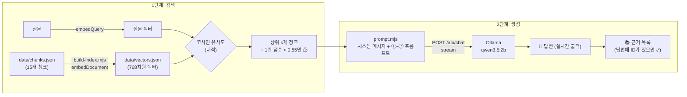

# 물류창고 재고 조사 안내 챗봇 (warehouse-rag)

## 1. 소개

물류창고에 새로 온 작업자가 재고 실사 절차와 용어를 물어보면, SOP와 공개 자료를 근거로 답해 주는 챗봇입니다. 내 PC에서만 실행합니다.

- **답하는 것**: 재고·재고관리 용어(재고의 정의, ABC 분석, 선입 선출법, WMS, RFID와 바코드), 현장 SOP(순환재고조사, 실사 차이 처리, 안전 수칙), 입고 검수 절차
- **답하지 않는 것**: 실시간 재고 수량. "A-01 재고 몇 개야?" 같은 질문에는 자료로 알 수 없다고 답하고 **WMS에서 확인하라**고 안내합니다.
- 만들지 않은 것: 웹 화면, 서버, 배포, WMS 연동, 로그인

## 2. 동작 원리



1. 청크마다 `"title: 섹션 | text: 본문"`을 임베딩해 768차원 벡터로 `data/vectors.json`에 저장합니다.
2. 질문은 `"task: search result | query: 질문"`으로 임베딩하고, 모든 청크와 내적(= 코사인 유사도)을 구해 점수 높은 순으로 k개(기본 3개)를 고릅니다.
3. 1위 점수가 0.55(`WEAK_THRESHOLD`)보다 낮으면 "관련 자료가 약함"을 표시하고, 프롬프트의 근거 원칙도 "주의" 문장으로 바꿉니다.
4. 시스템 메시지와 ①자료 소개 ②근거 원칙 ③출처 규칙 ④KST 현재 시각 ⑤[자료] ⑥[질문] ⑦출처 규칙 반복을 조립해 Ollama에 보내고, 답을 실시간으로 출력합니다.
5. 근거 표시는 LLM에 맡기지 않습니다. LLM에 넘긴 자료를 모두 보여 주고, 답변에 그 ID 글자가 있는 자료에만 ✓를 붙입니다.

## 3. 사용 기술

| 구분 | 사용한 것 |
|---|---|
| 실행 환경 | Node.js (ES 모듈, 직접 확인한 버전 v22.22.3) |
| 임베딩 라이브러리 | transformers.js (`@huggingface/transformers`) |
| 임베딩 모델 | `onnx-community/embeddinggemma-300m-ONNX`, dtype `q8`, 768차원, `{ pooling: "mean", normalize: true }` |
| 임베딩 입력 형식 | 모델 공식 프롬프트 형식 — 문서 `title: {section} \| text: {text}`, 질문 `task: search result \| query: {question}` |
| LLM | Ollama `qwen3.5:2b` (`POST /api/chat`, `stream: true`, `think: false`, `temperature: 0`) |

## 4. 실행 방법

**준비** (처음 한 번)

```bash
ollama pull qwen3.5:2b
npm install
```

**1) 인덱스 만들기**: 청크를 임베딩해 `data/vectors.json`을 만듭니다. `data/chunks.json`을 바꿀 때마다 다시 실행합니다.

```bash
node src/build-index.mjs
```

**2) 검색만 해 보기 (1단계)**: 질문을 여러 개 한 번에 넣을 수 있습니다. `--k`로 결과 개수를 바꿉니다.

```bash
node src/search.mjs "재고 실사 차이가 나면 어떻게 처리해?" "ABC 분석이 뭐야?"
```

**3) 답변 받기 (2단계)**: Ollama가 실행 중이어야 합니다.

```bash
node src/ask.mjs "재고 실사 차이가 나면 어떻게 처리해?"
```

| 옵션 | 설명 |
|---|---|
| `--k 3` | LLM에 넘길 검색 결과 개수 (기본 3) |
| `--show-prompt` | LLM을 부르지 않고, 조립된 시스템·사용자 메시지만 출력합니다. Ollama 없이도 동작합니다. |
| `--no-rag` | 비교 실험용. 검색 없이, 시스템 메시지도 빼고 질문만 LLM에 보냅니다. |

질문 없이 `node src/ask.mjs`로 실행하면 대화형 모드가 됩니다. `질문>` 뒤에 한 줄씩 입력하고, `exit`·`quit`·Ctrl+C로 끝냅니다. 질문끼리는 서로 독립입니다.

## 5. 자료

| id | section | 출처 |
|---|---|---|
| WH-001 | 재고의 정의 | [위키백과: 재고](https://ko.wikipedia.org/wiki/%EC%9E%AC%EA%B3%A0) |
| WH-002 | 재고자산의 정의와 종류 | [위키백과: 재고자산](https://ko.wikipedia.org/wiki/%EC%9E%AC%EA%B3%A0%EC%9E%90%EC%82%B0) |
| WH-003 | 재고의 범위 | [위키백과: 재고관리](https://ko.wikipedia.org/wiki/%EC%9E%AC%EA%B3%A0%EA%B4%80%EB%A6%AC) |
| WH-004 | 재고관리의 목적 | [위키백과: 재고관리](https://ko.wikipedia.org/wiki/%EC%9E%AC%EA%B3%A0%EA%B4%80%EB%A6%AC) |
| WH-005 | 상비품과 비상비품 | [위키백과: 재고관리](https://ko.wikipedia.org/wiki/%EC%9E%AC%EA%B3%A0%EA%B4%80%EB%A6%AC) |
| WH-006 | 재고수량 계산식 | [위키백과: 재고관리](https://ko.wikipedia.org/wiki/%EC%9E%AC%EA%B3%A0%EA%B4%80%EB%A6%AC) |
| WH-007 | ABC 분석 | [위키백과: ABC 분석](https://ko.wikipedia.org/wiki/ABC_%EB%B6%84%EC%84%9D) |
| WH-008 | 선입 선출법(FIFO) | [위키백과: 선입 선출법과 후입 선출법](https://ko.wikipedia.org/wiki/%EC%84%A0%EC%9E%85_%EC%84%A0%EC%B6%9C%EB%B2%95%EA%B3%BC_%ED%9B%84%EC%9E%85_%EC%84%A0%EC%B6%9C%EB%B2%95) |
| WH-009 | 창고 관리 시스템(WMS) | [위키백과: 창고 관리 시스템](https://ko.wikipedia.org/wiki/%EC%B0%BD%EA%B3%A0_%EA%B4%80%EB%A6%AC_%EC%8B%9C%EC%8A%A4%ED%85%9C) |
| WH-010 | RFID와 바코드의 차이 | [위키백과: RFID](https://ko.wikipedia.org/wiki/RFID) |
| WH-011 | 순환재고조사 | [docs/sop.md#순환재고조사](docs/sop.md) |
| WH-012 | 실사 차이 처리 | [docs/sop.md#실사-차이-처리](docs/sop.md) |
| WH-013 | 안전 수칙 | [docs/sop.md#안전-수칙](docs/sop.md) |
| WH-014 | 입고 검수 순서 | [docs/receiving.md#입고-검수-순서](docs/receiving.md) |
| WH-015 | 입고 수량 불일치 | [docs/receiving.md#입고-수량-불일치](docs/receiving.md) |

`docs/sop.md`와 `docs/receiving.md`는 교육용 예시 문서입니다. 실제 회사의 절차가 아니며, SOP의 조사 주기(A등급 매월, B등급 분기, C등급 반기)도 예시로 정한 값입니다.

**청크 설계 원칙**

1. **한 청크에 한 가지 내용**: 공개 자료는 사실 하나, 직접 쓴 자료는 `##` 절 하나를 담습니다. 앞 문맥 없이 읽혀야 하므로 최소 120자로 씁니다.
2. **원문에 없는 말을 보태지 않습니다.** 예외적으로 두 곳은 앞 문맥 없이 읽히도록 손봤습니다. WH-006 앞에 "재고수량을 정할 때"를 붙였고, WH-005에서 "앞에서 말한 바와 같이"를 뺐습니다.
3. **확인 가능한 출처와 바뀌지 않는 id**: 웹 자료는 퍼센트 인코딩된 URL, 직접 쓴 자료는 `docs/파일명.md#제목`을 적습니다. id는 WH-001부터 연속으로 붙이고, 한 번 붙인 id의 뜻은 바꾸지 않습니다. 공개 자료는 원문을 저장하지 않고 청크와 URL만 둡니다.

## 6. 1단계 관찰 기록

`node src/search.mjs`로 15개 청크 기준, 상위 3개를 기록했습니다.

| # | 질문 | 1위 | 2위 | 3위 | ⚠ |
|---|---|---|---|---|---|
| 1 | 재고 실사 차이가 나면 어떻게 처리해? | WH-012 실사 차이 처리 0.793 | WH-015 입고 수량 불일치 0.743 | WH-001 재고의 정의 0.610 | |
| 2 | 실사 수량이 장부랑 안 맞으면? | WH-012 실사 차이 처리 0.707 | WH-015 입고 수량 불일치 0.671 | WH-006 재고수량 계산식 0.624 | |
| 3 | ABC 분석이 뭐야? | WH-007 ABC 분석 0.737 | WH-011 순환재고조사 0.544 | WH-005 상비품과 비상비품 0.457 | |
| 4 | RFID랑 바코드 차이 | WH-010 RFID와 바코드의 차이 0.814 | WH-014 입고 검수 순서 0.531 | WH-008 선입 선출법(FIFO) 0.493 | |
| 5 | 안전재고는 어떻게 계산해? | WH-006 재고수량 계산식 0.706 | WH-001 재고의 정의 0.630 | WH-002 재고자산의 정의와 종류 0.594 | |
| 6 | A등급 품목은 얼마나 자주 세? | WH-011 순환재고조사 0.638 | WH-007 ABC 분석 0.633 | WH-005 상비품과 비상비품 0.578 | |
| 7 | 우리 창고 지금 A-01 재고 몇 개야? | WH-015 입고 수량 불일치 0.554 | WH-001 재고의 정의 0.541 | WH-011 순환재고조사 0.536 | |
| 8 | 내일 날씨 어때? | WH-006 재고수량 계산식 0.454 | WH-005 상비품과 비상비품 0.427 | WH-011 순환재고조사 0.425 | ⚠ |
| 9 | 김치찌개 레시피 알려줘 | WH-006 재고수량 계산식 0.445 | WH-005 상비품과 비상비품 0.370 | WH-011 순환재고조사 0.369 | ⚠ |

### 생각해 볼 것

- **2번처럼 단어가 겹치지 않아도 찾을 수 있는 이유는?** 임베딩이 단어가 아니라 뜻을 비교하기 때문입니다. "장부랑 안 맞으면"이라고 물어도 "센 수량과 시스템 수량이 다르면"으로 시작하는 WH-012가 1위(0.707)입니다.
- **8·9번도 1위 청크는 항상 나옵니다.** 검색은 "가장 가까운 것"을 고를 뿐, "답이 있는지"는 모릅니다. 그래서 점수 기준(0.55)이 필요합니다. 8번(0.454)과 9번(0.445)은 기준 아래라 ⚠가 붙었습니다.
- **7번은 기준을 통과해 버립니다(0.554).** 검색 점수만으로는 "실시간 수량은 자료에 없다"를 걸러 낼 수 없습니다. → 2단계에서 LLM에게 규칙(시스템 메시지)으로 알려 줘야 하는 이유입니다.
- **5번의 2위처럼 단어 하나에 끌려 엉뚱한 청크가 올라오기도 합니다.** 이 프로젝트에서는 "재고"라는 단어에 끌려 안전재고 계산과 관계없는 WH-001 재고의 정의가 2위(0.630)에 올랐습니다. 그래서 LLM에게 "근거에 있는 것만" 쓰라고 해야 합니다.

이 세 가지가 "왜 검색만으로는 부족하고 2단계(생성)가 필요한가"에 대한 답입니다.

### 생각해 볼 것: md 문서 추가 실습

`docs/receiving.md`(WH-014, WH-015)를 추가하기 전과 후의 검색 결과입니다.

| 질문 | 추가 전 1위 | 추가 후 1위 |
|---|---|---|
| 트럭이 도착하면 입고 검수는 어떤 순서로 해? | WH-013 안전 수칙 0.593 | WH-014 입고 검수 순서 0.781 |
| 입고할 때 수량이 명세서랑 다르면 어떻게 해? | WH-012 실사 차이 처리 0.672 | WH-015 입고 수량 불일치 0.761 |
| 재고 실사 차이가 나면 어떻게 처리해? (2위) | WH-001 재고의 정의 0.610 | WH-015 입고 수량 불일치 0.743 |

- **추가 전에도 ⚠ 경고가 뜨지 않았습니다.** 점수는 0.593, 0.672로 기준(0.55)을 넘었지만 내용은 엉뚱했습니다. 특히 "입고 수량이 다를 때"에 "실사 차이 처리"가 나온 것은 비슷해 보이지만 다른 상황입니다. 점수 기준만으로는 "맞는 자료인지"를 보장할 수 없습니다. → 2단계에서 이 자료로 LLM이 답하면 실사 절차를 입고 절차처럼 말할 수 있습니다.
- **자료를 넣자 정확한 청크가 높은 점수로 1위가 됐습니다.** RAG의 답변 품질은 자료가 있느냐에 가장 크게 좌우됩니다.
- **상관없어 보이는 "재고 실사 차이" 질문도 2위가 바뀌었습니다.** 자료를 추가하면 다른 질문의 결과도 달라질 수 있으므로, 자료를 바꿀 때마다 STEP 5의 질문들을 다시 돌려 보는 습관이 필요합니다.

## 7. 2단계 비교 실험 기록

`node src/ask.mjs "질문" --no-rag`와 `node src/ask.mjs "질문"`의 결과입니다. CLAUDE.md 생성 계약과 맞춘 뒤의 결과입니다. 시스템 메시지는 수량 질문에 "제가 가진 자료에는 없습니다. 재고 수량은 WMS에서 확인하세요"라고 답하도록 정했고, 출처 규칙의 예시 ID는 `[WH-012]`입니다. `temperature: 0`이라 같은 질문에는 같은 답이 나옵니다. `--no-rag` 열은 시스템 메시지를 쓰지 않으므로 이 변경의 영향을 받지 않습니다.

| 질문 | RAG 없이 (핵심 문장) | RAG (핵심 문장) | [WH-xxx] 표시 | 지어낸 내용? | 내 판단 |
|---|---|---|---|---|---|
| A등급 품목은 얼마나 자주 세? | "A 등급 품목의 빈도는 매우 다양하며, 이는 주로 국가별 통계 기준, 세무 당국의 분류 방식 … 에 따라 크게 달라집니다." ("세다"를 세금으로 이해) | "[A 등급 품목은 매월 조사한다.]" | ID 자리에 `[A]` 표시 (ID 아님), ✓ 없음 | RAG 없이: 있음(세무 등급 이야기, 근거 없는 "세입의 10% 이상" 기준) / RAG: 없음 | RAG가 맞음. 답(매월 조사)은 SOP와 일치하지만, ID 자리에 `[A]`를 붙여 출처는 직접 확인해야 함 |
| 재고 실사 차이가 나면 어떻게 처리해? | "재고 실사 (실제 존재 여부) 와 재고 적자 (실적) 가 일치하지 않을 때 … 체계적인 절차를 따릅니다." (회계 처리로 흐름) | "[WH-012] 재실사에서도 차이가 남으면 먼저 아직 처리되지 않은 입고·출고·이동 전표가 있는지 확인하고, 그다음 인접 로케이션에 같은 품목이 잘못 놓였는지 확인한다." | [WH-012] ✓ | RAG 없이: 있음(공정가를 "Cost of Goods Sold"로 표기 등 회계 이야기) / RAG: 없음 | RAG가 맞음. 재실사 이후 확인 단계를 자료대로 말했고 출처 WH-012도 정확함. 다만 원인 분류와 관리자 승인 단계는 빠짐 |
| ABC 분석이 뭐야? | "ABC 분석은 유동성, 중요도, 또는 가치에 따라 제품, 고객, 부서, 혹은 프로젝트 등을 분류하고 관리하는 전략적 도구입니다." | "ABC 분석은 일반적으로 소수의 품목이 대부분을 좌우하고 다수의 품목이 적은 부분을 차지하는데, 여기서 전자를 A 그룹, 후자를 C 그룹이라 하며 … 효과적으로 관리할 수 있다." (WH-007 원문에 가까움) | 없음 (ID 없음), ✓ 없음 | RAG 없이: 있음(등급별 비율이 서로 맞지 않음) / RAG: 없음 | RAG가 더 정확함. 다만 출처 ID가 빠져 ✓가 붙지 않음 |
| 우리 창고 지금 A-01 재고 몇 개야? | "죄송하지만 저는 현재 특정 창고의 실시간 재고 데이터를 확인하거나 조회할 수 있는 기능이 없습니다." | "제가 가진 자료에는 없습니다. 재고 수량은 WMS 에서 확인하세요" | 없음, ✓ 없음 | 둘 다 숫자를 지어내지 않음 | RAG가 맞음. 자료에 없다고 밝히고 WMS 안내를 함. 검색 1위 점수가 0.554라 ⚠ 경고는 붙지 않음 |
| 내일 날씨 어때? | "죄송하지만 저는 실시간 날씨 정보를 제공하지 못합니다." | "제가 가진 자료에는 없습니다." | 없음 (⚠ 약한 근거 경고 표시) | 둘 다 날씨를 지어내지 않음 | RAG가 맞음. 자료에 없다고 밝히고 ⚠ 경고도 표시됨 |

### 자료를 빼고 넣어 비교한 실험

`docs/receiving.md`의 청크(WH-014, WH-015)를 잠시 빼고 `node src/build-index.mjs` → `node src/ask.mjs "입고할 때 수량이 명세서랑 다르면 어떻게 해?"`를 실행한 뒤, 다시 넣고 같은 순서로 실행했습니다. 데이터는 실험 뒤 원래대로 되돌렸습니다.

| | receiving.md 뺀 상태 (13청크) | receiving.md 넣은 상태 (15청크) |
|---|---|---|
| 검색 1위 | WH-012 실사 차이 처리 0.672 | WH-015 입고 수량 불일치 0.761 |
| 답변 (앞부분) | "[WH-012] (실사 차이 처리) 센 수량과 시스템 수량이 다르면 바로 조정하지 않고, 처음 센 사람이 아닌 다른 작업자가 같은 로케이션을 다시 센다. …" | "[WH-015] 거래명세서 수량과 실제 박스 수량이 다르면 입고 등록을 멈추고 차이 수량을 입고 이상 보고서에 기록한다." |
| [WH-xxx] 표시 | [WH-012] (실사 절차를 인용) | [WH-015] ✓ |

- 자료가 없을 때 LLM은 **실사 차이 처리 절차를 입고 절차처럼** 말했습니다. 검색 점수가 0.672로 기준을 넘었기 때문에 ⚠ 경고도 없었습니다.
- 자료를 넣자 입고 등록 중단과 입고 이상 보고서 기록처럼 입고 상황에 맞는 답이 나왔고, 출처 WH-015도 ✓로 표시됐습니다.

## 8. 한계와 다음 단계

**2B 모델의 한계**

- **출처 규칙을 완전히 따르지 않습니다.** 예시 ID를 `[WH-012]`로 맞춘 뒤에도 A등급 질문은 ID 자리에 `[A]`를 썼고, ABC 질문은 ID를 쓰지 않았습니다. 실사 질문의 `[WH-012]`는 예시 ID와 실제 근거가 같아서, 예시를 베낀 것인지 근거를 본 것인지 구분할 수 없습니다.
- **받은 자료를 억지로 쓰려 한 적이 있습니다.** 이전 문구에서는 A-01 질문에 관계없는 재고 정의를 "따라서"로 이어 붙였고, 그 자료에 ✓가 붙었습니다. ✓는 "답변에 ID가 적혔다"는 뜻일 뿐 실제 근거라는 보장이 아닙니다. 수량 질문 거절 문구를 고친 뒤에는 이 현상이 나타나지 않았습니다.
- **지시를 일부만 따릅니다.** 실사 질문에서 재실사 이후 단계까지만 말하고, 관리자 승인 단계는 빠뜨렸습니다.
- **자료가 없으면 엉뚱한 쪽으로 갑니다.** `--no-rag`에서는 "세다"를 세금으로, 재고 실사를 회계 처리로 이해했고, 답에 다른 언어 글자가 섞이기도 했습니다.

**검색만으로 "답이 없음"을 판단하기 어려운 점**

- 7번(A-01 재고, 0.554)은 자료에 답이 없는데도 기준 0.55를 넘었습니다. 기준 근처의 질문은 경고도, "주의" 근거 원칙도 붙지 않아 LLM이 관계없는 자료로 답을 만들 수 있습니다.
- receiving.md를 뺀 실험에서도 엉뚱한 자료(WH-012, 0.672)가 기준을 넘어, LLM이 실사 절차를 입고 절차처럼 답했습니다.
- 반대로 6번(A등급)처럼 1위와 2위 차이가 0.005밖에 안 나는 경우도 있어, 점수만으로 "맞는 자료"를 고르기 어렵습니다.
- 지금 청크는 15개라 질문 대부분이 "재고"라는 공통 단어에 끌린 청크를 함께 불러옵니다.

**다음에 해 볼 것**

- 답변에 적힌 ID 가운데 넘기지 않은 자료의 ID를 따로 알려 주기
- 질문을 더 모아 `WEAK_THRESHOLD`(0.55)가 적절한지 다시 보기
- 검색에 `--hybrid`(코사인 + BM25)를 쓰면 결과가 어떻게 달라지는지 비교하기 (현재 한국어 조사 처리가 단순해 효과는 확인하지 못했습니다)
- WH-008(선입 선출법)은 회계상 원가 계산 방법이라 현장의 "먼저 들어온 것 먼저 내보내기" 작업 규칙과 뜻이 다릅니다. 현장 규칙을 SOP에 따로 쓰기
